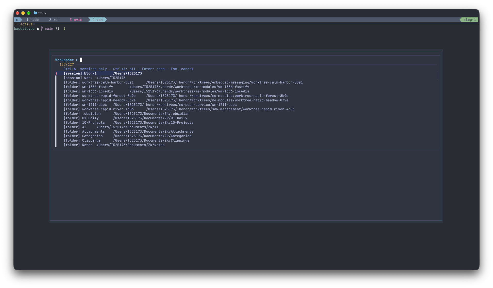

+++
title = "From a Folder Picker to a tmux Workspace Switcher"
date = 2026-10-30
draft = false
description = "Evolving a Bash and fzf folder picker into a tmux workspace switcher that discovers Git worktrees and reuses existing sessions."

[taxonomies]
tags = ["tech", "tmux"]
+++

A small tmux sessionizer can make moving between projects almost effortless: choose a directory with `fzf`, then create or attach to a session for it.

That was enough until Git worktrees entered the picture. A project was no longer just one directory. It could have a main checkout, several feature branches in separate worktrees, and existing tmux sessions running agents or development servers.

The question changed from “Which folder do I want?” to **“Which workspace do I want to return to?”**

Here is how I evolved a simple folder picker into a workspace switcher—without turning it into another project-management tool.

## What the picker does

The finished workflow starts with **prefix, then `f`**. My prefix is `Ctrl+A`; substitute yours if it is different.

[](workspace-picker.png)

A popup lists two kinds of entries:

```text
[session] feature-login    /home/me/projects/web-app__worktrees/feature-login
[session] docs             /home/me/notes
[folder] web-app           /home/me/projects/web-app
[folder] feature-login     /home/me/projects/web-app__worktrees/feature-login
```

Session entries point to something already running. Folder entries are places where a session can be reused or created.

Inside the picker:

| Key | Action |
| --- | --- |
| Type | Fuzzy-search the entries |
| `Ctrl+S` | Show existing sessions only |
| `Ctrl+A` | Show sessions and folders again |
| `Enter` | Open the selected workspace |
| `Esc` | Cancel |

The filters preserve the search query. The popup closes after a successful selection, leaving the chosen session visible.

## Discover workspaces, not every directory

Recursively searching an entire home directory is rarely a useful project picker. It quickly fills with dependency folders, build output, and repositories’ internal directories.

Instead, the script starts with a few explicit search roots:

```bash
"$HOME/projects"
"$HOME/work/repos"
"$HOME/notes"
```

It lists their immediate subdirectories and skips missing roots quietly. Two additions make that shallow search useful with worktrees:

1. **Workmux containers.** By default, Workmux creates worktrees in a sibling directory named `<repo>__worktrees`. The picker lists that container’s immediate children instead of treating the container as a project.
2. **Git’s worktree registry.** For discovered directories, it asks Git for registered worktrees with `git worktree list --porcelain -z`. This also finds worktrees stored outside the configured search roots.

Existing tmux sessions are listed independently of folder discovery, so they remain reachable even when their directories are somewhere else.

This is deliberately not an exhaustive filesystem index. For example, a repository at `~/projects/team/web-app` needs `~/projects/team` added as a search root if it is not otherwise discoverable.

## A session name is a label, not an identity

The original script used a directory’s basename as the tmux session name. That is convenient until two repositories have the same name:

```text
~/projects/api
~/work/repos/api
```

Looking up the session named `api` cannot tell those directories apart.

The revised script first resolves the selected directory to a physical, absolute path, then compares it with each session’s `session_path`. It only creates a session if no match exists.

New sessions still get readable names. If the basename is already taken, the script adds a checksum-derived suffix, with a numeric fallback for further collisions. The checksum helps generate a name; it is not the identity check.

When choosing an existing session directly, the picker uses tmux’s session ID, such as `$3`, rather than trying to reconstruct a target from its display name.

There is one important boundary: `session_path` is the session’s recorded starting directory, not the current directory of every pane inside it. If another tool starts sessions from a generic directory, choose their explicit `[session]` entries rather than expecting directory-based matching to identify them.

## Keep display text separate from selection data

Each picker row contains four tab-separated fields:

```text
kind    target    display-label    display-path
```

For a session, the target is its tmux ID. For a directory, it is the full path.

`fzf --with-nth=3..` shows only the friendly label and path, while the original row remains available when an entry is selected. This avoids parsing a path back out of a decorated label.

The session-only shortcut changes the input rather than inserting a magic search term. `Ctrl+S` reloads the script in a data-only mode; `Ctrl+A` reloads all entries. Neither data-only mode creates or attaches to a session.

## The complete script

Save this as `~/.config/scripts/tmux-sessionizer` and adjust the search roots to match your own directory layout.

This implementation uses Bash, Git, tmux, `fzf`, and standard utilities including `find`, `sort`, `cksum`, and `awk`. The popup binding below was tested with **tmux 3.8 and fzf 0.74.4 on macOS**; check compatibility before using it with older versions.

```bash
#!/usr/bin/env bash
# Project/worktree picker. Also accepts a directory directly.
set -euo pipefail

client=''
if [[ ${1:-} == --client ]]; then
    client=${2:?Missing tmux client}
    shift 2
fi
if (( $# > 1 )); then
    printf 'Usage: %s [--client CLIENT] [DIRECTORY]\n' "$0" >&2
    exit 1
fi

canonical_path() {
    (cd -- "$1" 2>/dev/null && pwd -P)
}

session_rows() {
    tmux list-sessions -F $'#{session_id}\t#{session_name}\t#{session_path}' 2>/dev/null || true
}

find_session() {
    local wanted=$1 id name path resolved
    while IFS=$'\t' read -r id name path; do
        [[ -n "$id" ]] || continue
        resolved=$(canonical_path "$path") || continue
        if [[ "$resolved" == "$wanted" ]]; then
            printf '%s\n' "$id"
            return
        fi
    done < <(session_rows)
}

project_directories() {
    local root directory record
    for root in "$HOME/projects" "$HOME/work/repos" "$HOME/notes"; do
        [[ -d "$root" ]] || continue
        while IFS= read -r -d '' directory; do
            if [[ "$directory" == *__worktrees ]]; then
                find "$directory" -mindepth 1 -maxdepth 1 -type d -print0
                continue
            fi
            printf '%s\0' "$directory"
            while IFS= read -r -d '' record; do
                if [[ "$record" == 'worktree '* ]]; then
                    printf '%s\0' "${record#worktree }"
                fi
            done < <(git -C "$directory" worktree list --porcelain -z 2>/dev/null || true)
        done < <(find "$root" -mindepth 1 -maxdepth 1 -type d -print0)
    done
}

session_picker_rows() {
    local id name path
    while IFS=$'\t' read -r id name path; do
        [[ -n "$id" ]] || continue
        printf 'session\t%s\t[session] %s\t%s\n' "$id" "$name" "$path"
    done < <(session_rows)
}

picker_rows() {
    local directory
    session_picker_rows

    while IFS= read -r directory; do
        printf 'directory\t%s\t[folder] %s\t%s\n' "$directory" "${directory##*/}" "$directory"
    done < <(
        while IFS= read -r -d '' directory; do
            canonical_path "$directory" || true
        done < <(project_directories) | LC_ALL=C sort -u
    )
}

# Data-only commands for fzf reloads.
case ${1:-} in
    --list-sessions) session_picker_rows; exit 0 ;;
    --list-all) picker_rows; exit 0 ;;
esac

if (( $# == 1 )); then
    selected=$1
    target=''
else
    reload_command=$(printf '%q' "$0")
    choice=$(picker_rows | fzf --delimiter=$'\t' --with-nth=3.. \
        --layout=reverse --border --no-preview --prompt='Workspace > ' \
        --bind="ctrl-s:reload($reload_command --list-sessions)+change-prompt(Sessions > )" \
        --bind="ctrl-a:reload($reload_command --list-all)+change-prompt(Workspace > )" \
        --header='Ctrl+S: sessions only · Ctrl+A: all · Enter: open · Esc: cancel') || exit 0
    [[ -n "$choice" ]] || exit 0
    IFS=$'\t' read -r kind selected label path <<< "$choice"
    target=''
    if [[ "$kind" == session ]]; then
        target=$selected
    fi
fi

if [[ -z "$target" ]]; then
    selected=$(canonical_path "$selected") || {
        printf 'Directory does not exist.\n' >&2
        exit 1
    }
    target=$(find_session "$selected")
    if [[ -z "$target" ]]; then
        base=$(basename -- "$selected" | tr '.:' '__')
        [[ -n "$base" && "$base" != / ]] || base=workspace
        name=$base
        suffix=$(printf '%s' "$selected" | cksum | awk '{print $1}')
        n=0
        while tmux has-session -t "=$name" 2>/dev/null; do
            name="${base}-${suffix}"
            if (( n > 0 )); then name="${name}-${n}"; fi
            n=$((n + 1))
        done
        target=$(tmux new-session -d -P -F '#{session_id}' -s "$name" -c "$selected")
    fi
fi

if [[ -n "$client" ]]; then
    tmux switch-client -c "$client" -t "$target"
elif [[ -n ${TMUX:-} ]]; then
    tmux switch-client -t "$target"
else
    tmux attach-session -t "$target"
fi
```

Make it executable:

```sh
chmod +x ~/.config/scripts/tmux-sessionizer
```

It can also be invoked directly, inside or outside tmux:

```sh
~/.config/scripts/tmux-sessionizer "$HOME/projects/web-app"
```

Outside tmux it attaches to the selected session; inside tmux it switches the client.

## The popup bug that the first tests missed

The first popup binding launched the script with a client format embedded directly in its command:

```text
# This did not work in the tested tmux version.
bind-key f display-popup -E '~/.config/scripts/tmux-sessionizer --client #{q:client_name}'
```

The popup immediately disappeared.

The script’s selection logic had passed tests, but those tests had not exercised this launch path. In the tested tmux version, the popup command did not expand that format. Passed to the shell unquoted, the literal `#` began a comment, leaving `--client` without its required argument.

The fix was to expand the format in `run-shell` first, then pass the resolved client explicitly to both the popup and the script:

```text
# ~/.config/tmux/tmux.conf
# Keep this binding on one line.
bind-key f run-shell -b 'tmux display-popup -c #{q:client_name} -w 85% -h 70% -s "bg=#2e3440,fg=#d8dee9" -S "bg=#2e3440,fg=#89c0d0" -EE "$HOME/.config/scripts/tmux-sessionizer" --client #{q:client_name}'
```

There are a few deliberate choices here:

- **An explicit client:** selection switches the client that opened the picker, rather than relying on an implicit target.
- **Separate command arguments:** tmux receives the executable and its arguments separately, avoiding another layer of shell-command quoting.
- **Percentage dimensions:** the popup scales with the terminal.
- **Explicit colors:** the popup does not inherit an unexpectedly pale background.
- **`-EE`:** the popup closes on success but remains visible if its command exits unsuccessfully.

Reload the configuration:

```sh
tmux source-file ~/.config/tmux/tmux.conf
```

No server restart is necessary.

One diagnostic limitation remains: the script currently treats an unsuccessful picker pipeline as cancellation. That means `-EE` cannot expose every `fzf` failure. For a more hardened version, distinguish expected cancellation from unexpected picker errors instead of mapping all of them to a successful exit.

## Where Workmux fits

Workmux and the sessionizer have different jobs:

- **Workmux creates and manages worktrees**, including their configured agent and pane layouts.
- **The sessionizer navigates directories and existing tmux sessions.**

For a session-per-worktree workflow, Workmux supports this global setting:

```yaml
# ~/.config/workmux/config.yaml
mode: session
```

With a shell alias such as `wm=workmux`, `wm add feature-login` can create a worktree and its session. The sessionizer can then find that session alongside unrelated projects.

Selecting a `[folder]` entry does **not** invoke `workmux add` or start a configured agent layout. If there is no matching session, it creates a plain tmux session in that directory. That separation is intentional: the picker should not quietly perform worktree lifecycle operations.

Likewise, deleting worktrees or cleaning up branches after a pull request merge remains a Workmux or Git operation—not something this picker does.

## Test the interaction, not just the script

A syntax check is useful:

```sh
bash -n ~/.config/scripts/tmux-sessionizer
```

But the immediately closing popup demonstrated why it is not enough.

The checks for this workflow covered:

- Directory names containing spaces.
- Two directories with the same basename.
- Reusing an existing session instead of creating another.
- Missing search roots.
- Default Workmux containers and externally located registered worktrees.
- Cancelling without creating a session.
- Opening the actual popup with real `fzf`.
- Switching between sessions-only and all entries.
- Selecting a session and switching the originating client.

The interactive checks ran in a separate tmux server under a pseudo-terminal. That exercised the real keybinding and popup without touching the working sessions.

There are still sensible limits for a personal script: the picker’s tab-separated, line-oriented records assume names do not contain tabs or newlines; directory-based reuse is based on `session_path`; and discovery intentionally stays shallow. Making those boundaries explicit is better than claiming it finds every possible workspace.

## Keep the switcher small

The useful improvements were not elaborate previews or more status information. They were about making navigation predictable:

- Existing sessions are first-class choices.
- Worktrees are discoverable without scanning the entire filesystem.
- A full directory path matters more than a convenient basename.
- Sessions-only mode is one keystroke away.
- Cancelling does not leave a temporary window behind.

The result is still a small Bash script, but it now answers the question that matters during a working day: **where do I want to continue?**
